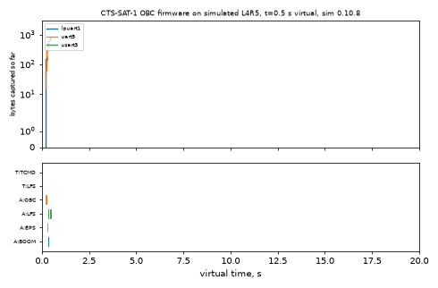
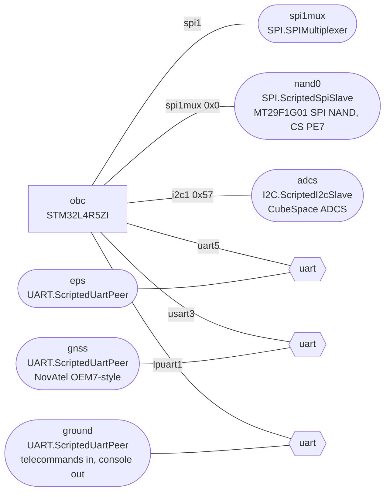

<!-- simantic-banner -->
> **Run this firmware with no hardware.** [Simantic](https://simantic.com) simulates the whole board, peripherals, sensors and buses included. Try it free at **[simantic.com](https://simantic.com)**, or run it locally: `curl -fsSL https://simantic.com/install | sh`

## This fork: the flight firmware on a simulated STM32L4R5

This is Simantic's fork of CalgaryToSpace's CTS-SAT-1 OBC firmware. It runs the flight firmware, unmodified, on a
simulated STM32L4R5ZI with its external devices attached, then commands it over its debug UART the way the ground
station does. No board, no bench. No firmware or source file in this fork is changed; only this README.

**What runs:** the upstream ELF built from commit `1c98525` (FreeRTOS, `CTS-SAT-1_FW.elf`) on Simantic's `sim`
(pyrite engine, model `STM32L4R5ZI`). The scenario, peers and pre-built ELF live in Simantic's
`sim-fixtures` repository (branch `l4r5/cts-sat-1-obc`,
`tests/stm/nucleo-l4r5zi/cts-sat-1-obc/`), not here.

**Run it from this fork** (`sim` 0.10.8, build 64f89c38, 2026-11-25; the scenario, peers and ELF are copied into [`sim/`](sim/)):

```
cd sim && sim run --scenario scenario.yaml --ascii lpuart1 --timeout 20 > run.log
python3 make_gif.py run.log timeline.gif "sim 0.10.8"     # optional, matplotlib + pillow
```



*Animation drawn from [`sim/run.log`](sim/run.log), the run's own capture: bytes seen on each UART link (the debug console is a text capture so its count is approximate) and the firmware's own log lines by tag. 20 s of virtual time; the run took 11 s of CPU time on a laptop (about 0.6 s per virtual second). On this run every message listed below appeared and none of the absent ones did (LittleFS mount, `hello_world`, EPS enable of channel 8, ADCS run mode, GNSS `log timea once`, `hello.txt` read back as hex and listed as 18 B; no `HardFault`, `GNSS ERROR`, `[A:LFS:CRIT]`, `[A:EPS:ERR]`).*

**The scenario**, as `sim graph --scenario` prints it. The square box is the simulated MCU running the firmware, the
rounded boxes are the modelled parts around it, and the hexagons are the UART links:



| Device | Bus (pins) | Peer |
| --- | --- | --- |
| External flash (LittleFS) | SPI1 (PE13/14/15), CS PE7 | Micron MT29F1G01 SPI NAND, 128 MiB, 2048 B pages; the part the driver's ID check (`2C 14`) names |
| EPS | UART5 (PC12/PD2) | `<cmd>...</cmd>` / `<rsp>...</rsp>` frames; fixed housekeeping |
| CubeSpace ADCS | I2C1 (PG14/PG13), address 0x57 | ADCS stand-in: identification, boot status, state, run mode, command ack, CRC-8 |
| GNSS | USART3 (PC4/PC5) | NovAtel OEM7 ASCII: `log timea once`, `log bestxyza once`, CRC32 trailer |
| Ground station | LPUART1 (PG7/PG8) | sends the telecommands below at fixed virtual times; the console text is the reply |

**The telecommands sent** (1 s apart; the firmware polls its UART, so about 0.75 s is needed): `hello_world`;
`eps_get_system_status_json`; `eps_set_channel_enabled(gnss,1)`; `eps_get_enabled_channels_json`;
`eps_get_pbu_housekeeping_data_eng_json`; `adcs_identification`; `adcs_program_status`; `adcs_set_run_mode(1)`;
`adcs_get_current_state_1`; `gnss_send_cmd_ascii(log timea once)`; `fs_write_file_str`; `fs_read_file_hex`;
`fs_list_directory`.

**What the test asserts** (`test.yaml`): the run must show
- boot: `MX_Init() done`, all non-default EPS channels disabled, `LittleFS mounting successful!`, the `./logs` and `ADCS`
  directories created, `Completed LFS_init()`, and the state change `BOOTED_AND_WAITING` to `NOMINAL_WITHOUT_RADIO_TX`;
- `hello_world` executed and answered;
- EPS: system status JSON, `EPS enable channel 8 (3V3_GNSS) executed.`, `"3V3_GNSS"]` in the enabled list, housekeeping
  JSON (3300 mV internal supply, 8117 mV input);
- ADCS: identification (node type 10, firmware 1.12), program status (boot cause 3), `adcs_set_run_mode` executed,
  run mode 1 read back;
- GNSS: a `<OK` response with `FINESTEERING,2445,` and `,VALID*`;
- LittleFS: `hello.txt` written, read back as hex of `CTS-SAT-1 persists`, and listed;
- peer logs show the EPS, ADCS and GNSS commands arriving (`EPS cc=0x40`, `ADCS TC 10 payload=0141`,
  `GNSS cmd 'log timea once'`);
- and none of these appear: `lfs_mount() ->`, `[A:LFS:CRIT]`, `[A:EPS:ERR]`, `timeout before first byte`,
  `Error disabling EPS channel`, `GNSS ERROR`, `HardFault`.

**Console excerpts** from a run of the full scenario (`sim` 0.10.2, pyrite engine; edited only by removing the
byte-by-byte UART trace lines and trimming long lines):

```
[0.242487s] (lpuart1 → ground) MX_Init() done
[0.334855s] (lpuart1 → ground) 1790000020000+0000000084_E [A:LFS:INFO]: LittleFS mounting successful!
[0.453304s] (lpuart1 → ground) 1790000020000+0000000203_E [A:LFS:INFO]: Successfully created directory: ADCS
[4.443487s] (lpuart1 → ground) 1790000020000+0000004167_E [A:OBC:INFO]: CTS1 operation state changed from BOOTED_AND_WAITING to NOMINAL_WITHOUT_RADIO_TX (Condition 2: RBF == BENCH).
[ground] GROUND TX CTS1+hello_world()!
[6.463128s] (lpuart1 → ground) 1790000020000+0000006187_E [T:TCMD:INFO]: Hello, world!
[ground] GROUND TX CTS1+eps_set_channel_enabled(gnss,1)!
[8.493266s] (lpuart1 → ground) EPS enable channel 8 (3V3_GNSS) executed.
[9.279510s] (lpuart1 → ground) [,"3V3_GNSS"]
[11.512845s] (lpuart1 → ground) {"node_type":10,"interface_version":1,"major_firmware_version":1,"minor_firmware_version":12,"seconds_since_startup":11,"ms_past_second":507}
[13.282160s] (lpuart1 → ground) 1790000020000+0000013006_E [T:TCMD:INFO]: .... Executing telecommand 'adcs_set_run_mode'.
[adcs] ADCS TC 10 payload=0141 ack=[10, 1, 0, 0]
[15.589239s] (lpuart1 → ground) [COM1]#TIMEA,COM1,0,50.0,FINESTEERING,2445,129633.570,02000000,9924,16809;VALID,1.1e-09,2.4e-09,-18.00000000049,2026,11,16,12,0,15570,VALID*cdf6881d
[16.520904s] (lpuart1 → ground) 1790000020000+0000016244_E [T:LFS:INFO]: Successfully wrote data to file: hello.txt
[17.557961s] (lpuart1 → ground) 4354532D5341542D31207065727369737473
```

The run exits 0 in about 11 s of wall clock, and the same scenario passes Simantic's smoke runner with every assertion
above. To re-run it, check out `sim-fixtures` at the PR branch (`l4r5/cts-sat-1-obc`) and run, from its root:

```
sim run --scenario tests/stm/nucleo-l4r5zi/cts-sat-1-obc/test.yaml --ascii lpuart1 --timeout 20
python3 scripts/run_smoke.py <sim> --engine pyrite tests/stm/nucleo-l4r5zi/cts-sat-1-obc
```

(`test.yaml` also carries the harness-only `expect*` keys, which `sim run` on its own rejects; the smoke runner is the
supported way to check the assertions.)

**Configurations tried:**

| Configuration | Result |
| --- | --- |
| No peers (the ELF alone on the `STM32L4R5ZI` model) | Boots and reaches `NOMINAL_WITHOUT_RADIO_TX` (4.85 s into the run). Every EPS exchange fails: `EPS->OBC: timeout before first byte received`, `Successfully disabled: 0 channels. Failed to disable 14 channels!`. `lfs_mount() -> -84`. |
| NAND attached but blank, other peers attached | `lfs_mount()` fails with `-84` at boot, as above: the firmware only formats LittleFS on the `fs_format_storage` telecommand. |
| NAND with a formatted LittleFS image, EPS, ADCS, GNSS and ground attached | Passes: the full list of assertions above. |
| EPS replying after 2 ms rather than at once | Needed. A reply that starts immediately loses its first ~4 bytes, because after its transmit the firmware clears a 310-byte buffer before arming receive. A real EPS cannot answer faster than that, so the 2 ms delay is the peer being realistic, not a model workaround. |

The no-peers excerpt (from the boot with nothing attached):

```
MX_Init() done
<cmd>..@.</cmd>
0000000000000+0000000052_N [A:EPS:ERR]: EPS->OBC: timeout before first byte received
...
0000000000000+0000000836_N [A:EPS:ERR]: Successfully disabled: 0 channels. Failed to disable 14 channels!
0000000000000+0000000856_N [A:LFS:CRIT]: Error: lfs_mount() -> -84
0000000000000+0000004852_N [A:OBC:INFO]: CTS1 operation state changed from BOOTED_AND_WAITING to NOMINAL_WITHOUT_RADIO_TX (Condition 2: RBF == BENCH).
```

The blank-NAND and 2 ms rows are from the fixture's notes; the no-peers and full-scenario rows are from runs of the
scenario above.

**What is not simulated:** FRAM (CS PE8/PE9, unused by the driver), the camera, the MPI, the AX100 radio (USART2) and
the antenna and temperature I2C buses; the firmware does not need them to reach nominal. Sensor values are fixed (EPS
housekeeping is 8.1 V and 21.6 C, the GNSS is always locked), and the ADCS has no attitude dynamics: it answers zeros
with a valid CRC for frames it does not implement. The SPI NAND is a scripted device, since pyrite has no SPI NAND model.
No comparison against hardware has been done yet on this firmware: everything here is simulator output.

**Two observations on the firmware**, noted while building the peers, not changed here:
- `ADCS_i2c_send_command_and_check` reads `ack.processed` before `ack` is initialised.
- `eps_get_enabled_channels_json` prints a leading comma (`[,"3V3_GNSS"]`).

Everything below is CalgaryToSpace's README.

---

# CTS-SAT-1-OBC-Firmware
Onboard Computer (OBC) Firmware and ground support software for the CTS-SAT-1 ("FrontierSat") mission. Firmware runs on the STM32-based Onboard Computer.

## Quick Links - Getting Started

* [Getting Started Guide](/docs/00_Getting_Started.md)
* [Firmware Documentation File List](/docs/) (start with `00_Getting_Started.md`)
* [CTS-SAT-1 Ground Support Software](https://github.com/CalgaryToSpace/CTS-SAT-1-Ground-Support/)
* [Doxygen Documentation](https://calgarytospace.github.io/CTS-SAT-1-OBC-Firmware)

## Contributors

Please add your name to the list below in your first Pull Request!

* Parker L.
* Nadeem M.
* Chris K.
* Kale F.
* Marko V.
* Vaibhav K.
* Muhammad Ali
* Saksham P.
* Alex O.
* Fardin M.
* Shaan Samresh
* Kevin Hoang
* Celina Hy
* Meagan D.

## License and Libraries

This bulk of this project is licensed under the MIT License. See the [LICENSE](LICENSE) file for details.

This project includes the following libraries, each with their own licenses:

1. **STM32CubeIDE HAL library**, which is licensed under a variety of licenses. See applicable licenses in applicable sub-folders.
	* The gist is that the usage is very permissive, as long as you buy real STM32 chips.
2. **FreeRTOS**
3. **CMSIS**
4. **LittleFS:** Licensed under the BSD-3-Clause license.
